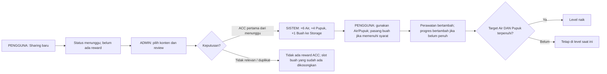
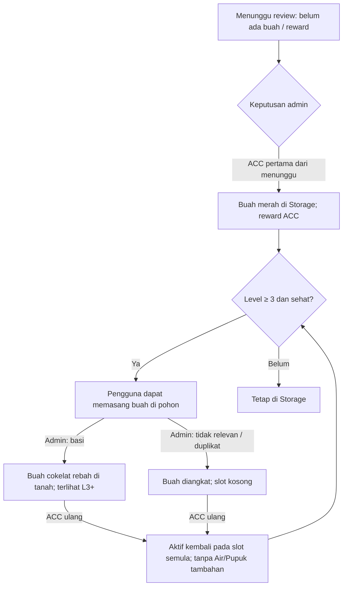
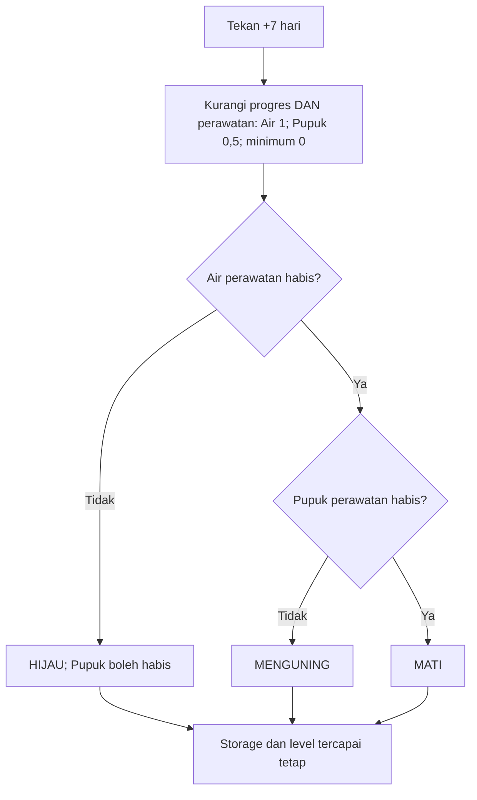

# Panduan Simulator Pohon Kebunku

**Versi:** 13 November 2026 · revisi rapat Probis · desain Pengguna/Admin tetap.

**Buka simulator:** https://kebunku-tree-simulator.testtry.workers.dev

> Simulator menjelaskan alur dan aturan. Tombol Pengguna/Admin bukan login atau
> autentikasi; seluruh perubahan hanya ada dalam memori tab, tanpa database akun.

## 1. Peta peran

**ACC** berarti konten disetujui / dinyatakan relevan oleh admin.

| Bagian | Yang dilakukan | Yang tidak dilakukan |
|---|---|---|
| Pengguna | Login simulasi, Learning, ulasan, Sharing, siram, pupuk, pasang buah | Memutuskan ACC/basi/tidak relevan/duplikat |
| Admin | Pilih konten, tentukan status, lihat akibatnya pada kebun pengguna | Mengambil reward atau merawat sebagai pengguna |
| Sistem | Menghitung reward, progres, level, kondisi, posisi buah | Memberikan reward hanya karena berganti tampilan |
| Alat demo | +7 hari, uji kondisi, +1 Air, +1 Pupuk, Boost, level naik/turun, muat contoh | Mewakili aktivitas normal atau kontribusi nyata |

## 2. Flowchart utama: Sharing sampai pertumbuhan



**Langkah pada layar:** Aktivitas → Sharing baru → Lanjut ke admin → pilih
keputusan → Lihat Storage pengguna → Rawat.

**ACC ulang:** buah aktif kembali di slot semula, tanpa tambahan Air/Pupuk.
Berganti peran tidak menghapus atau menggandakan state.

## 3. Tiga angka yang harus dibedakan

| Kelompok angka | Makna | Bertambah saat | Berkurang saat | Menentukan |
|---|---|---|---|---|
| Storage | Persediaan yang belum dipakai | Mendapat reward / Boost demo | Dipakai merawat atau memasang buah | Apakah persediaan cukup |
| Progres | Akumulasi pertumbuhan | Air/Pupuk dipakai dan target resource belum penuh | Decay | Kelayakan naik level |
| Sisa di pohon / perawatan | Cadangan yang menjaga kondisi | Air/Pupuk digunakan untuk merawat | Decay | Hijau, menguning, atau mati |

**Storage penuh tidak otomatis membuat pohon sehat. Resource perlu dipakai.**

| Tombol perawatan | Biaya Storage | Nilai perawatan | Progres |
|---|---|---|---|
| Siram | −1 Air | +1 Air | +1 Air jika target resource belum penuh |
| Pupuk | −1 Pupuk | +1 Pupuk | +1 Pupuk jika target resource belum penuh |
| Pasang buah | −1 buah tersimpan | Tidak berubah | Tidak berubah |

Jika progres resource sudah penuh dan perawatannya tidak perlu pemulihan,
resource tersebut tidak dihabiskan. Jika dipakai khusus pemulihan, progres
yang penuh tidak ditambah melewati target.

## 4. Reward normal

| Aktivitas | Air | Pupuk | Buah | Batas / syarat |
|---|---:|---:|---:|---|
| Login | +1 | — | — | Sekali per hari simulasi |
| Tuntas Learning | — | +1 | — | Sekali per materi; klik berikutnya mewakili materi baru |
| Beri bintang | +1 | — | — | Materi terakhir sudah tuntas; sekali per materi |
| Sharing baru | — | — | — | Menunggu review |
| ACC pertama | +6 | +4 | +1 | Transisi dari status menunggu; masuk Storage |
| ACC ulang | — | — | Aktif kembali | Tanpa tambahan Air/Pupuk; slot semula |

Di simulator, tombol Learning mewakili penuntasan materi dan tombol **Beri
bintang** memberi contoh **5 bintang saja**, tanpa menyimpan komentar. Tidak ada
kuis atau form komentar. Perubahan 17 November ini khusus simulator dan flowchart;
aplikasi KMS utama tetap memakai alur ulasannya sendiri.

## 5. Level dan formula

**Syarat level L:** `progres Air ≥ target Air L` **DAN**
`progres Pupuk ≥ target Pupuk L`.

| Level | Tahap | Air kumulatif | Pupuk kumulatif |
|---|---|---:|---:|
| 0 | Tanah kosong | 0 | 0 |
| 1 | Bibit | 1 | 1 |
| 2 | Daun | 3 | 2 |
| 3 | Mulai berbuah | 7 | 5 |
| 4 | Pohon besar | 27 | 18 |
| 5 | Cabang kiri | 52 | 30 |
| 6 | Cabang kanan | 77 | 42 |
| 7 | Pohon penuh | 101 | 54 |

Angka adalah **target total**, bukan biaya tambahan per level.
Contoh L2 → L3 tanpa decay: tambahan `7 − 3 = 4 Air` dan `5 − 2 = 3 Pupuk`.
Progres 7 Air / 4,5 Pupuk belum memenuhi L3.

Revisi Probis menetapkan reward Sharing 6 Air / 4 Pupuk dan target L3 7/5.
Angka L4–L7 masih memakai parameter sebelumnya karena angka penggantinya belum
ditetapkan dalam notulensi. Bonus awal 1/1 ditambah satu Sharing ACC cukup untuk
mencapai L3 setelah dipakai merawat; tidak otomatis naik level saat ACC.

## 6. Flowchart status konten dan buah



| Status | Tampilan buah | Posisi / ketentuan |
|---|---|---|
| Menunggu | Belum ada buah | Belum menghasilkan slot buah |
| ACC / relevan | Merah matang | Storage; dapat dipasang pada pohon sehat L3+ |
| Basi | Cokelat busuk | Rebah dekat batang, terlihat L3+; berlaku pada buah yang sudah ada |
| Tidak relevan | Tidak ada buah | Buah diangkat, slot kosong; bukan buah kuning |
| Duplikat | Tidak ada buah | Buah konten duplikat diangkat; buah konten asli tetap |

- Slot milik konten bersifat tetap; buah lain tidak bergeser.
- Saat pohon menguning, mati, atau turun di bawah L3, buah yang menggantung
  kembali ke Storage. Setelah sehat, pengguna memasangnya lagi.
- Buah basi tetap menjadi arsip di tanah.
- Slot 1–7 digambar langsung. Kelebihan jumlah memakai penanda `+n`.

## 7. Flowchart +7 hari dan kondisi



| Air di pohon | Pupuk di pohon | Kondisi |
|---|---|---|
| Masih ada | Masih ada atau habis | Hijau |
| Habis | Masih ada | Menguning |
| Habis | Habis | Mati |

**Rumus:** `nilai baru = maks(0, nilai lama − pengurangan × jumlah periode)`.

Tombol waktu **tidak memaksa kuning pada klik pertama atau mati pada klik kedua**.
Kondisi selalu mengikuti sisa perawatan. Progres juga berkurang, tetapi saldo
Storage dan level tercapai tidak dipotong.

### Contoh L3 tanpa aktivitas/perawatan tambahan

| Klik +7 hari | Hari | Air di pohon | Pupuk di pohon | Kondisi |
|---:|---:|---:|---:|---|
| 0 | 0 | 7 | 5 | Hijau |
| 1 | 7 | 6 | 4,5 | Hijau |
| 2 | 14 | 5 | 4 | Hijau |
| 6 | 42 | 1 | 2 | Hijau |
| 7 | 49 | 0 | 1,5 | Menguning |
| 9 | 63 | 0 | 0,5 | Menguning |
| 10 | 70 | 0 | 0 | Mati |

Pada Reset L0, perawatan awal hanya 1 Air / 1 Pupuk. Dengan nilai awal tersebut,
satu periode dapat menghabiskan Air. Itu hasil pengurangan, bukan aturan jumlah klik.

## 8. Panduan tombol berdasarkan peran

### Sisi Pengguna

1. **Rawat:** Siram, Pupuk, Pasang buah.
2. **Aktivitas:** Login, Materi baru, Beri bintang, Sharing baru.
3. **Konten saya:** lihat status dan slot; tidak tersedia keputusan admin.
4. Setelah Sharing, tekan **Lanjut ke admin** untuk melanjutkan contoh review.

### Sisi Admin

1. Pilih **Admin** pada pengubah sudut pandang atau tombol handoff.
2. Pilih kartu konten; konten terpilih memiliki penanda.
3. Tekan ACC, Basi, Tidak relevan, atau Duplikat sesuai skenario.
4. Tekan **Lihat Storage pengguna** untuk memeriksa hasil dan kembali merawat.

Di HP maupun desktop, pohon berada di atas dan panel aksi berada di bawahnya
untuk kedua peran.

### Alat demo — bukan aksi normal

| Tombol | Efek |
|---|---|
| +7 hari | Maju satu periode dan menerapkan decay |
| Menguning | Mengatur Air perawatan menjadi 0, Pupuk tetap positif |
| Mati | Mengatur Air dan Pupuk perawatan menjadi 0 |
| Sehatkan | Memulihkan perawatan agar positif; tidak mengembalikan progres yang hilang |
| +1 Air | Menambah 1 Air ke Storage setiap klik; progres dan perawatan tetap |
| +1 Pupuk | Menambah 1 Pupuk ke Storage setiap klik; tidak menuntaskan Learning; progres dan perawatan tetap |
| Boost | +10 Air, +6 Pupuk, +1 Buah bonus ke Storage; progres tidak bertambah |
| Level +1 | Mengisi progres dan cadangan perawatan sesuai ambang level berikutnya |
| Level −1 | Menurunkan level/progres sebagai jalan pintas demo |
| Contoh berbuah | Memulai ulang contoh L3 dengan tiga konten ACC dan tiga buah terpasang |
| Reset | Konfirmasi inline; kembali ke L0 dengan persediaan awal |

**Contoh awal L3:** Storage 19 Air / 13 Pupuk / 0 Buah; progres 7/5;
perawatan 7/5; 3 buah menggantung. Storage berasal dari bonus awal 1/1 dan tiga
Sharing ACC masing-masing 6/4. Progres demo diisi melalui jalan pintas level,
bukan dipotong dari Storage; contoh ini bukan riwayat pertumbuhan normal akun.

## 9. Skenario uji cepat

| Uji | Langkah | Hasil yang benar |
|---|---|---|
| Pemisahan peran | Buka Pengguna lalu Admin | Aksi sesuai peran, state tidak direset |
| Alur Sharing | Reset → Sharing → Admin ACC | Reward ke Storage, bukan langsung naik level |
| Reward ulang | ACC konten yang sudah ACC | Tidak ada Air/Pupuk kedua kali |
| Syarat buah | Coba pasang buah di bawah L3 | Tidak bisa; buah tetap tersimpan |
| Basi | Contoh L3 → Admin Basi | Buah cokelat di tanah |
| Slot tetap | Contoh L3 → angkat satu buah | Slot lain tidak bergeser |
| Decay bertahap | Contoh L3 → +7 hari dua kali | 5 Air / 4 Pupuk di pohon, tetap hijau |
| Mati | Lanjut sampai keduanya habis | Mati; level tetap, Storage tetap |
| Pemulihan Air | Mati → Siram dengan Storage cukup | Hijau meskipun Pupuk perawatan masih 0 |
| Pemulihan Pupuk | Mati → Pupuk tanpa menyiram | Menguning; Air masih 0 |
| Reload | Muat ulang halaman | Contoh awal L3, kembali ke sisi Pengguna |

## 10. Arsitektur dan batasan

```text
Browser
  ├─ HTML + CSS + JavaScript
  ├─ roles.js → kepemilikan aksi simulasi
  ├─ simulation.js → tindakan & state di memori
  ├─ engine/gamification.js → perhitungan aturan
  └─ engine/tree-svg.js → gambar SVG berdasarkan state

Vite build → dist/ → Cloudflare Worker: kebunku-tree-simulator
```

| Berkas | Tanggung jawab |
|---|---|
| `index.html` | Struktur layar dua peran, tabel aturan, disclosure |
| `src/main.js` | Rendering, perpindahan peran, event tombol, feedback |
| `src/roles.js` | Pemetaan aksi pengguna/admin/demo; guard UI |
| `src/simulation.js` | Menjalankan tindakan simulasi tanpa API |
| `src/engine/gamification.js` | Reward, level, care, decay, dan ledger buah |
| `src/engine/tree-svg.js` | Batang, cabang, tajuk, buah, dan kondisi SVG |
| `src/compact-layout.css` | Responsivitas dan tampilan ringkas dua peran |
| `wrangler.jsonc` | Deployment simulator terpisah, hanya static assets |

- Tidak ada login sungguhan, database Neon, atau penulisan akun asli.
- State hanya berada di memori tab; tidak ada penyimpanan lintas perangkat.
- Waktu hanya maju ketika tombol +7 hari ditekan.
- Guard role di simulator bukan batas keamanan backend; aplikasi KMS asli
  memiliki autentikasi/otorisasi server yang terpisah.
- Nilai di dokumen adalah nilai bawaan simulator. Parameter KMS asli dapat
  diubah admin dan tidak otomatis disinkronkan ke simulator.
- Pupuk disimpan sebagai unit internal: 2 unit = 1 Pupuk.

**Verifikasi versi ini:** 47 tes simulator dan 114 cek browser live lulus;
0 exception JavaScript dan 0 request API KMS sepanjang pengujian.

**Source di GitHub:** https://github.com/alfarissm/kms-knowledge-garden-prototype/tree/main/simulator-pohon
